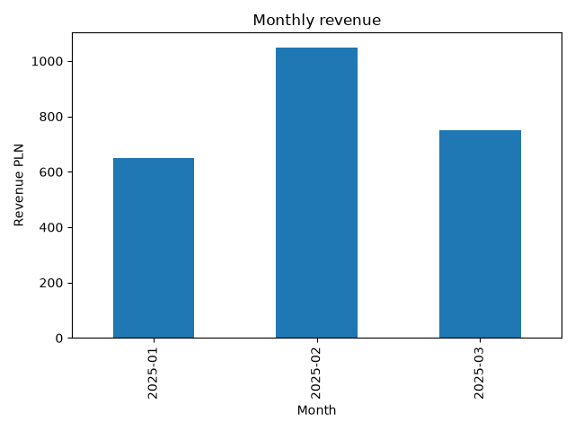

# E-commerce Sales Analysis

A beginner-friendly data analytics project built with **Python, PostgreSQL, Pandas, and Matplotlib**.

The project demonstrates how to retrieve data from a relational database, process it using Pandas, calculate monthly sales revenue, and visualize the results.

## Tech Stack

- **PostgreSQL** – relational database
- **SQL** – data retrieval and database structure
- **Python** – analysis workflow
- **Pandas** – data manipulation and aggregation
- **Matplotlib** – data visualization
- **SQLAlchemy & Psycopg** – PostgreSQL connection
- **python-dotenv** – environment configuration

## Project Structure

```text
ecommerce-sales-analysis/
├── database/
│   └── setup.sql
├── images/
│   └── monthly_revenue.png
├── main.py
├── requirements.txt
├── .gitignore
└── README.md
```

## Dataset

The project uses a fictional e-commerce dataset consisting of two tables.

**customers**

| Column | Description |
|---|---|
| customer_id | Unique customer identifier |
| name | Customer name |
| city | Customer location |

**orders**

| Column | Description |
|---|---|
| order_id | Unique order identifier |
| customer_id | Customer identifier (foreign key) |
| order_date | Date of purchase |
| amount | Order value in PLN |

The sample database contains 5 customers and 8 orders across January–March 2025.

The database setup script is available in `database/setup.sql`.

## Analysis Workflow

1. Connect Python to PostgreSQL using SQLAlchemy and Psycopg.
2. Retrieve records from the `orders` table using SQL.
3. Load the query results into a Pandas DataFrame.
4. Convert the `order_date` column into a datetime format.
5. Group orders by month using `groupby()`.
6. Calculate monthly revenue using `sum()`.
7. Generate a bar chart with Matplotlib.

## Results

| Month | Total Revenue (PLN) |
|---|---:|
| January 2025 | 650 |
| February 2025 | 1,050 |
| March 2025 | 750 |

February had the highest revenue in this sample, while March revenue was lower than February.

### Monthly Revenue Visualization



## How to Run

### 1. Clone the repository

```bash
git clone https://github.com/AdrianCecko/ecommerce-sales-analysis.git
cd ecommerce-sales-analysis
```

### 2. Install dependencies

```bash
python -m pip install -r requirements.txt
```

### 3. Prepare the PostgreSQL database

Create a PostgreSQL database named `sales_analysis`.

Execute the following file in that database using Navicat or another SQL client:

```text
database/setup.sql
```

This creates the `customers` and `orders` tables and inserts sample data.

### 4. Configure environment variables

Create a `.env` file in the project root:

```dotenv
DB_USER=postgres
DB_PASSWORD=your_password
DB_HOST=localhost
DB_PORT=5433
DB_NAME=sales_analysis
```

The `.env` file is excluded from Git using `.gitignore`.

### 5. Run the analysis

```bash
python main.py
```

The script retrieves order data from PostgreSQL, calculates monthly revenue, and displays a chart.

## Future Improvements

- Customer revenue analysis and segmentation
- Identifying returning customers
- Data quality checks and missing-value handling
- Additional business KPIs
- Power BI dashboard integration

## Project Status

**In progress**

This project is part of my practical learning journey in SQL, Python, and data analytics.
